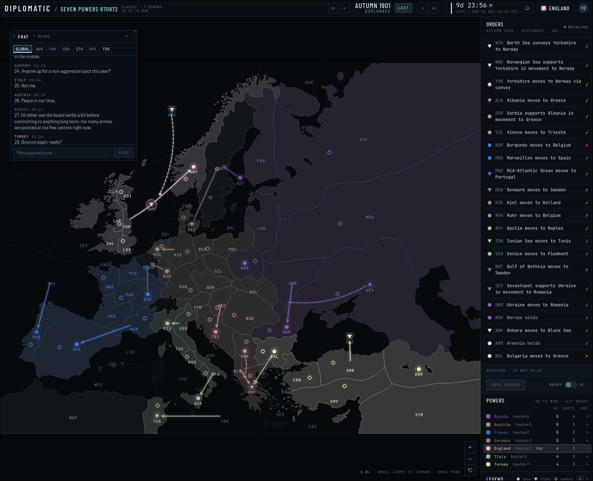

<h1 align="center">Diplomatic</h1>

<em>Negotiate. Betray. Prevail.</em>

  

---

Diplomatic is a web version of the Diplomacy board game: a few players, no
dice, and a map you click on instead of a form you fill in. It runs at
[diplomatic.live](https://diplomatic.live).

## Another Diplomacy web game? Really?

I know, I know. In my defence:

- *it was fun* :)
- it gave me somewhere to try things for fifteen years
- I wanted to find out whether a board game's rulebook could be treated as physics
- losing friends over the internet scales better than doing it in person

## Is that CoffeeScript?!

Yep.

This repo was never a project, more like a playground I started
sometime around 2010. *Shipping it* wasn't really the plan; I just experimented
over the years whenever I found something new to learn.
A language, a framework, a paradigm.
Each visit left a layer on top of the previous one, and
nobody ever cleaned up, because nobody was ever going to see it.

Then *agents emerged*, and I realised I could publish it.

A lot of those layers are gone now. What you find here is what survived:
Python, Rust, CoffeeScript, HAML and some hand-written JavaScript, living
together in a way no one would design on purpose. The CoffeeScript still
runs the board. It works, and it has seniority.

## The adjudicator

The one part of this repository that was designed on purpose.

Adjudicating a Diplomacy turn is a circular problem: whether a unit moves
depends on a support, which depends on whether it gets cut, which depends
on whether some other unit moves. The usual answer is an algorithm that
walks the orders in a clever sequence and guesses its way out of the loops.

`diplomatico` doesn't walk anything. It treats the turn as a landscape:
every order is a push, supports add height, and a unit enters a province
only if it stands strictly higher than everything else there.

The trouble is that the shape of the landscape depends on the outcome. So
wherever orders chase each other in a loop, the provinces involved stay in
superposition, kept and taken at once, and every possible world gets asked
the same question: once assumed, does it produce exactly itself? A world
at rest under its own gravity. The superposition collapses to that world,
and that world is the turn.

Diplomacy being Diplomacy, sometimes two worlds are at rest, or none. Those
are the game's famous paradoxes, and the only place where the rulebook is
allowed to overrule the physics: bridges fall, or everyone rolls.

It is a Rust core with Python around it, kept honest by 86 test cases
derived from the [DATC](https://webdiplomacy.net/doc/DATC_v3_0.html).

## License

Diplomatic is released under the BSD 3-Clause License.
